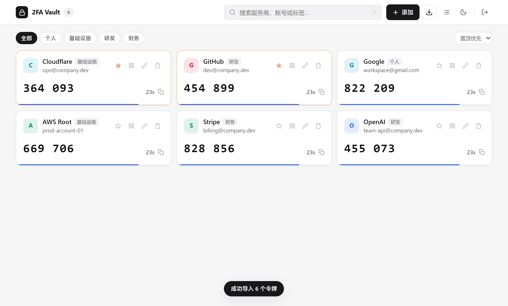
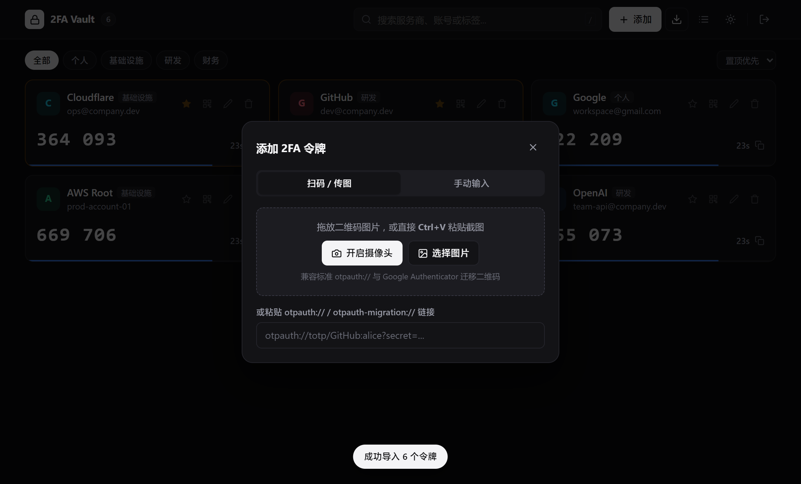
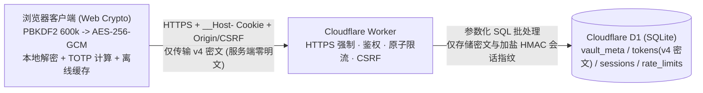

# 2FA Vault (`2fa-cfworker`)

基于 **Cloudflare Workers + Cloudflare D1** 的**端到端零知识加密（E2EE）**全 Serverless 在线 2FA (TOTP) 密钥库。**零本地编译、零 npm 依赖、零前端框架**，代码推送至 GitHub 即由云端自动完成语法校验与边缘发布。

---

## 界面预览

| 桌面端 · 深色模式 | 桌面端 · 浅色模式 |
| :---: | :---: |
|  |  |

| 扫码 / 传图添加弹窗 | 移动端自适应视图 |
| :---: | :---: |
|  |  |

---

## 核心特性

### 1. 真正的端到端零知识加密（Zero-Knowledge E2EE `v4`）
- **服务端与 CDN 零明文接触**：所有 2FA 令牌（含服务商、账号、Base32 种子、标签）均在**浏览器本地**经 **PBKDF2-SHA256（600,000 次迭代 + 32 字节随机盐）** 派生不可导出的 `AES-256-GCM` 密钥加密后才上传至 Cloudflare D1，并将记录 UUID 作为 **AAD（附加认证数据）** 绑定防跨行替换。端到端主密码永远不离开浏览器。
- **运行时内存零裸密钥驻留**：解锁后前端立即将 Base32 种子导入为 `extractable: false` 的 Web Crypto `HMAC CryptoKey` 并擦除字节数组，运行时状态与缓存键中不保留任何明文种子；仅在导出二维码、编辑查看或导出备份时按需瞬态解密。
- **无缝旧版迁移与在线主密码轮换**：若检测到库内存在旧版 `v3` 服务端加密记录，首次设置端到端主密码时自动在浏览器端全量重加密升级为 `v4` 密文；支持随时在「安全设置」中在线更换端到端主密码并原子重加密全库。
- **受信任设备免重复输入与一键锁定**：可选开启受信任设备解锁记忆（使用 IndexedDB 存储 `extractable: false` 的原生 `CryptoKey` 对象，无法导出原始密钥字节），顶栏提供一键「锁定」与「吊销其他全部登录设备」。

### 2. 真 PWA 离线可用与极速响应
- **断网 / 飞行模式完整可用**：内置原生 Service Worker (`/sw.js`) 缓存应用外壳与静态资源，并在本地保存纯 `v4` 密文快照；无网络或飞行模式下打开应用仍可通过主密码本地解密并正常计算动态口令，恢复联网后自动同步。
- **路径级内容哈希强缓存**：所有静态资源（`/assets/<hash>/app.css`、`/assets/<hash>/app.js`、`jsqr.js`、`qrcode.js`、`icon.svg`）均将 SHA-256 内容哈希嵌入 URL 路径而非 `?v=` 查询参数，彻底规避国内 CDN「忽略参数缓存」导致的旧版本残留问题。
- **极低 CPU/GPU 占用与 RTT 时钟补偿**：每秒仅更新倒计时文本与轻量 SVG 宽度属性，跨周期时计算一次 HMAC；基于请求往返中点（`RTT / 2`）自动检测并补偿本机时钟偏差。

### 3. 全格式扫码、严谨校验与加密备份
- **零外网 CDN 依赖**：自托管按需懒加载二维码识别与生成组件，支持摄像头节流扫码（带硬件防泄漏互斥锁）、拖拽上传、以及添加/导入弹窗内直接 `Ctrl+V` 粘贴截图。
- **严格防静默损坏校验**：支持标准 RFC 4648 带 `=` 填充的 `otpauth://` 链接与 Google Authenticator 批量迁移码（`otpauth-migration://`），严格拦截误输字符（如 `0/1/8/9` 或十六进制串）并明确提示不支持的 HOTP / 7 位口令条目，绝不静默丢字。
- **独立密码加密备份**：支持导出 **PBKDF2 (300,000 次) + AES-256-GCM 加密备份包 (`.enc.json`)**，同时兼容明文 JSON、`{ accounts, groups }` 备份及多行 `otpauth://` 文本导入，按解码后密钥字节精准去重。

---

## 系统与安全架构

### 安全防线矩阵

| 防护维度 | 实现细节 |
| :--- | :--- |
| **端到端零知识加密** | 浏览器本地 `PBKDF2-SHA256`（600,000 次，32 字节随机盐）派生不可导出 `AES-256-GCM` 密钥（强制校验 96-bit IV 与 128-bit Tag），主键 UUID 写入 AAD；服务端、D1 与前置 CDN 均无法解密任何令牌内容。 |
| **身份认证与会话指纹** | 登录凭据采用 `crypto.subtle.timingSafeEqual` 常量时间摘要比对；D1 `sessions.auth_fp` 使用每实例独立 32 字节随机盐 + 100,000 次 PBKDF2 派生的 `HMAC-SHA256` 签名（杜绝数据库泄露后的单轮哈希离线破解）。 |
| **防并发爆破与防锁死限流** | 基于 SQLite `INSERT ... ON CONFLICT DO UPDATE RETURNING` 原子预占配额（消除并发 TOCTOU 竞态）；自动将 IPv6 地址归并至 `/64` 子网前缀防地址池轮换；全局喷洒检测采用渐进式延迟（Tarpit）而非一刀切锁死合法主人登录。 |
| **强制 HTTPS 与会话安全** | 非本地回环地址强制 HTTPS（防反代 HTTP 回源降级）；签发 256-bit 随机令牌与 `__Host-vault_session`（`HttpOnly; Secure; SameSite=Strict; Path=/`）；支持一键吊销其他全部设备会话。 |
| **严格三层 CSRF 防护** | 所有状态变更请求（`POST` / `PUT` / `DELETE`）强制要求：① `X-Vault-Client: 1`；② 非空且严格匹配白名单的 `Origin`（禁止 `*` 通配符）；③ 合法 `Sec-Fetch-Site`。 |
| **严格 CSP 与供应链加固** | 每次页面请求生成 128-bit 随机密码学 Nonce，无 `'unsafe-inline'`；GitHub Actions 锁定最小只读权限与完整 40 位 Commit SHA，并在云端部署前自动执行零依赖语法与模块沙箱校验。 |

---

## 部署指南（全程云端，零本地编译）

### 第一步：创建并绑定 Cloudflare D1 数据库
1. 在 Cloudflare Dashboard → **Storage & Databases → D1 SQL Database** 创建数据库 `cf-2fa-vault-db`。
2. 将生成的 UUID 填入 [wrangler.toml](wrangler.toml) 的 `database_id`（首次访问时自动建表）。

### 第二步：配置云端自动部署
在 GitHub 仓库 **Settings → Secrets and variables → Actions** 中配置：
- `CLOUDFLARE_ACCOUNT_ID`：Cloudflare Account ID
- `CLOUDFLARE_API_TOKEN`：具备 **Workers Scripts (Edit)** 与 **D1 (Edit)** 权限的 API Token

推送代码至 `main` 分支后，[.github/workflows/deploy.yml](.github/workflows/deploy.yml) 将在云端自动完成语法校验并发布至 Cloudflare Workers。

### 第三步：配置 Worker 环境变量（建议全部使用 Secret 类型）
进入 Cloudflare Dashboard → **Workers & Pages → `2fa-cfworker` → Settings → Variables and Secrets**：

| 变量名 | 类型 | 必填 | 说明 |
| :--- | :--- | :---: | :--- |
| `AUTH_USERNAME` | Secret | 是 | 云端账户登录用户名 |
| `AUTH_PASSWORD` | Secret | 是 | 云端账户登录密码（修改后所有已登录会话立即失效，不影响 E2EE 令牌数据） |
| `ENCRYPTION_KEY` | Secret | **是** | 高熵随机密钥（建议 32 字节 Base64/Hex），用于服务端高成本会话指纹保护与旧版 `v3` 数据平滑迁移 |
| `ALLOWED_ORIGINS` | Secret / Text | 选填 | 使用 EdgeOne / 阿里云 ESA 等 CDN CNAME 反代并改写回源 `Host` 时填写前端访问域名（逗号分隔，不支持 `*`，如 `2fa.example.com`） |
| `TRUSTED_PROXY_SECRET` | Secret | 选填 | 反代回源鉴权密钥（让 CDN 回源注入请求头 `X-Proxy-Secret: <该值>`），验签通过后才会信任上游传入的访客 IP 头以保证限流精准 |
| `TRUSTED_IP_HEADER` | Text | 选填 | 配合 `TRUSTED_PROXY_SECRET` 指定真实 IP 头名称（默认依次读取 `EO-Connecting-IP`、`X-Real-IP`、`X-Forwarded-For`） |

---

## 内部 API 概览

| 方法 | 路径 | 说明 |
| :--- | :--- | :--- |
| `GET / HEAD` | `/api/health` | 健康检查（返回 D1 状态、环境变量完备度与 E2EE 初始化状态） |
| `GET` | `/api/bootstrap` | 首屏单次往返初始化（校验会话并返回 E2EE 元数据、`v4` 密文列表与边缘时间戳） |
| `POST` | `/api/auth/login` | 登录鉴权（含原子级 IPv6 `/64` 限流保护，签发 `__Host-` 会话 Cookie） |
| `POST` | `/api/auth/logout` | 退出当前登录会话并清理 Cookie |
| `POST` | `/api/sessions/revoke-others` | 一键吊销除当前浏览器外的所有其他活跃会话 |
| `POST` | `/api/e2ee/legacy-export` | 一次性导出旧版 `v3` 条目供浏览器本地升级重加密为 `v4` 零知识密文 |
| `POST` | `/api/e2ee/setup` | 初始化 E2EE 配置、提交 `v3 -> v4` 迁移密文或原子轮换端到端主密码 |
| `GET` | `/api/tokens` | 获取全部 `v4` 密文记录列表 |
| `POST` | `/api/tokens` | 新增单条客户端已加密的 `v4` 令牌记录 |
| `POST` | `/api/tokens/import` | 批量写入客户端已加密的 `v4` 令牌（自动分批，单库上限 1,000 条） |
| `PUT` | `/api/tokens/:id` | 更新指定 `v4` 密文记录或切换置顶状态（置顶不污染 `updated_at`） |
| `DELETE` | `/api/tokens/:id` | 永久删除指定令牌 |
