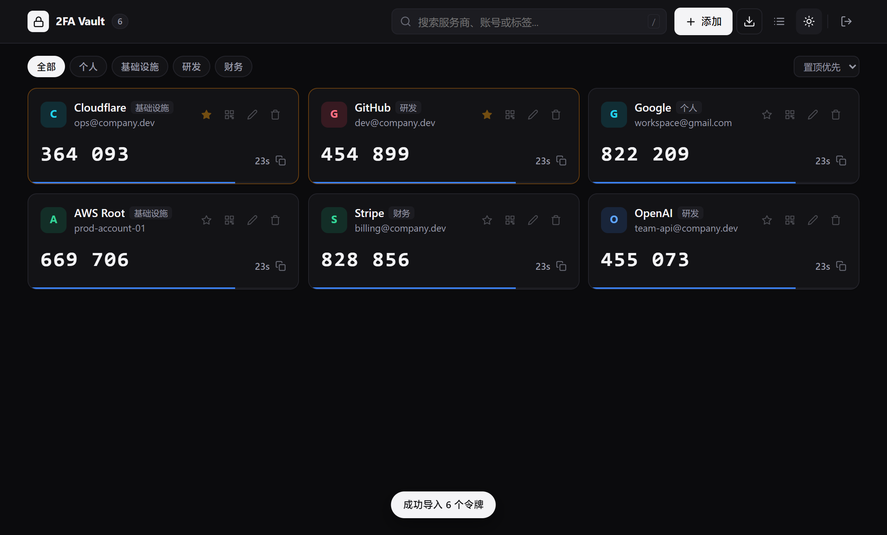
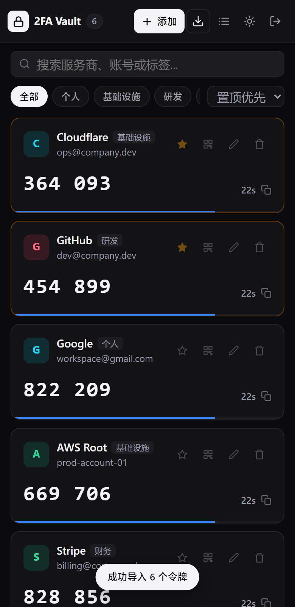
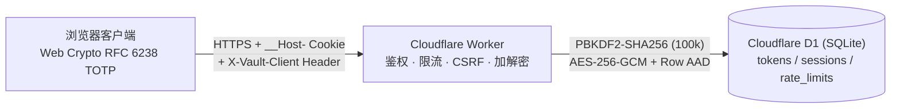

# 2FA Vault (`2fa-cfworker`)

基于 **Cloudflare Workers + Cloudflare D1** 的全 Serverless 在线 2FA (TOTP) 密钥库。**零本地编译、零 npm 依赖、零前端框架**，代码提交至 GitHub 即可由云端自动发布。

---

## 界面预览

| 桌面端 · 深色模式 | 桌面端 · 浅色模式 |
| :---: | :---: |
|  |  |

| 扫码 / 传图添加弹窗 | 移动端自适应视图 |
| :---: | :---: |
|  |  |

---

## 核心特性

### 1. 现代克制的交互体验
- **双主题自适应**：首屏无闪烁跟随系统浅色/深色模式，支持一键手动切换并持久化偏好。
- **双视图与多维筛选**：支持**卡片网格**与**紧凑列表**切换、分类标签横向滚动筛选、排序切换（置顶优先 / 名称 A-Z / 最近更新）以及实时搜索（快捷键 `/` 或 `Ctrl+K`）。
- **直觉化操作**：点击验证码区域直接复制并反馈状态；倒计时剩余 ≤ 5 秒时自动切换琥珀色提醒并提前展示**下一组验证码**；支持添加到手机/桌面主屏幕（PWA）。
- **全尺寸端适配**：桌面端高效多列排布；手机端自动切换为底部抽屉式弹窗（Bottom Sheet）、安全区内边距适配、16px 输入字号（防止 iOS Safari 点击输入框自动放大页面），在 320px 小屏至桌面宽屏下均无横向溢出。

### 2. 极速响应与低配设备友好
- **极小首屏与长期缓存**：HTML 外壳 gzip 仅 **~4.3 KB**，样式 `/app.css`（~4.9 KB gzip）与逻辑 `/app.js`（~13.7 KB gzip）均带内容哈希版本号并启用 `immutable` 一年强缓存；二维码识别与生成组件（`jsqr.js` / `qrcode.js`）仅在点击扫码或导出二维码时**按需懒加载**。
- **单次往返加载**：`/api/bootstrap` 在单次 HTTP 请求与单次 `D1.batch` 中同时完成会话校验与全部密文读取，Worker 使用 `Promise.all` 并发解密并复用 Isolate 内存中的派生密钥。
- **极低 CPU/GPU 占用**：
  - 彻底移除高开销的 `backdrop-filter` 毛玻璃模糊，卡片启用 `content-visibility: auto`。
  - 浏览器端缓存每个令牌的 Web Crypto `HMAC CryptoKey`，仅在 30 秒周期跨步时计算一次验证码，其余每秒仅更新文本与轻量 SVG 宽度属性；标签页切入后台时自动暂停定时器。
  - 服务端返回边缘节点标准时间，自动检测并补偿本机时钟偏差（≥ 15 秒时自动对齐）。

### 3. 全格式扫码、传图与迁移备份
- **零外网 CDN 依赖**：内置自托管 `/vendor/jsqr.js` 与 `/vendor/qrcode.js`，国内网络环境无需访问外部公共 CDN。
- **多种录入方式**：
  - **摄像头实时扫码**（自动节流至 ~8 fps，兼顾识别速度与低配手机发热控制）
  - **二维码图片识别**（支持文件选择、拖拽放入、以及弹窗内直接 `Ctrl+V` 粘贴截图）
  - **链接直接解析**：支持标准 `otpauth://totp/...` 与 **Google Authenticator 批量迁移二维码** (`otpauth-migration://offline?data=...` Protobuf 协议)
- **多格式导入与智能去重**：
  - 原生支持导入本应用 `.json` 备份、第三方 `{ accounts, groups }` 结构 JSON 备份、以及多行 `otpauth://` `.txt` 列表，默认开启指纹自动去重。
  - 支持单个令牌生成可扫描的 SVG 二维码，方便反向迁移回任意手机验证器 App。

---

## 系统与安全架构



### 安全机制一览（已通过多轮安全审计）

| 防护维度 | 实现细节 |
| :--- | :--- |
| **身份认证** | 用户名与密码存储在 Cloudflare Workers Secret 环境变量（`AUTH_USERNAME` / `AUTH_PASSWORD`），不开放外部注册；服务端使用 SHA-256 摘要做常量时间比对（防时序侧信道）。 |
| **防暴力破解与防喷洒** | 基于 D1 `rate_limits` 表的双层限流：**单 IP 限制**（仅信任 Cloudflare 边缘注入的 `CF-Connecting-IP`，防 `X-Forwarded-For` 伪造，15 分钟内最多 8 次失败）+ **全局防分布式代理池限制**（5 分钟内全局最多 40 次失败），超限返回 `429` 与 `Retry-After`。 |
| **会话管理与即时吊销** | 登录签发 256-bit 随机令牌，仅将 `SHA-256(sid)` 与账号密码指纹 `auth_fp` 存入 D1 `sessions` 表（上限保留最近 20 个活跃会话）。HTTPS 下强制使用 `__Host-vault_session` 前缀 Cookie（`HttpOnly; Secure; SameSite=Strict; Path=/`）。点击退出立即从 D1 销毁会话；修改 Worker 密码后所有历史会话立即自动失效。 |
| **三层 CSRF 防护** | 全部写操作（`POST` / `PUT` / `DELETE`）强制校验：① 自定义请求头 `X-Vault-Client: 1`；② `Origin` 必须严格等于当前源；③ `Sec-Fetch-Site` 仅允许 `same-origin` / `none`，彻底阻断跨站及同 `workers.dev` 兄弟子域请求伪造。 |
| **D1 落盘加密与防篡改** | 使用 `ENCRYPTION_KEY` 经 **PBKDF2-SHA256（100,000 次迭代）** 派生 256 位密钥，每个令牌使用独立 96-bit 随机 IV 进行 **AES-256-GCM** 加密，并将记录主键 `id` 作为 **AAD（附加认证数据）** 绑定到密文，防止数据库行间密文替换攻击。 |
| **严格 CSP 与防 XSS** | 每次响应生成 128-bit 随机密码学 Nonce，启用无 `'unsafe-inline'` 的严格 `Content-Security-Policy`（`script-src 'self' 'nonce-...'`, `style-src 'self'`），配合全量 HTML 转义、SVG 节点净化以及 `HSTS` / `X-Frame-Options: DENY` / `COOP` / `CORP` / `Permissions-Policy` 响应头。 |
| **防 DoS 与隐私细节** | 流式读取请求体并限制最大 `512 KB`（超限立即中断流并返回 `413`）；编辑已有令牌时密钥默认掩码隐藏；敏感输入框禁用浏览器表单自动填充历史（`autocomplete="off"`）。 |

---

## 目录结构

项目采用纯原生 ES Modules 拆分，**无需任何构建打包工具**即可直接运行在 Cloudflare Workers Runtime：

```text
.
├── .github/workflows/
│   └── deploy.yml          # GitHub Actions 零构建自动部署工作流
├── docs/screenshots/       # 界面预览截图
├── src/
│   ├── worker.js           # Worker 入口：路由、CSP、CSRF、限流、会话与 D1 加解密
│   ├── html.js             # 响应式页面骨架（含动态 CSP Nonce 注入）
│   ├── styles.js           # 浅色/深色双主题与移动端适配样式表 (/app.css)
│   ├── client.js           # 前端交互、缓存式 TOTP 引擎、扫码与导入导出 (/app.js)
│   ├── pwa.js              # Web App Manifest 与矢量图标 (/manifest.json, /icon.svg)
│   └── vendor/
│       ├── jsqr.js         # 自托管二维码图像解码库（按需懒加载）
│       └── qrcode.js       # 自托管二维码 SVG 生成库（按需懒加载）
├── wrangler.toml           # Cloudflare Workers 与 D1 数据库绑定配置
└── README.md
```

---

## 部署指南（零本地依赖）

### 第一步：创建 Cloudflare D1 数据库

1. 登录 Cloudflare Dashboard → **Storage & Databases** → **D1 SQL Database** → 点击 **Create Database**，命名为 `cf-2fa-vault-db`。
2. 复制生成的 `Database ID`（UUID 格式），修改仓库根目录 [wrangler.toml](wrangler.toml) 中的 `database_id`：
   ```toml
   name = "cf-2fa-vault"
   main = "src/worker.js"
   compatibility_date = "2025-01-01"

   [[d1_databases]]
   binding = "DB"
   database_name = "cf-2fa-vault-db"
   database_id = "替换为你的-D1-Database-ID"
   ```
   > 首次访问时 Worker 会自动创建所需的 `tokens`、`sessions`、`rate_limits` 表及索引，无需手动执行 SQL 迁移。

### 第二步：关联 GitHub 自动部署（二选一）

#### 方案 A：使用内置 GitHub Actions（已配置就绪）
在 GitHub 仓库的 **Settings → Secrets and variables → Actions** 中添加以下两个 Repository Secrets：
- `CLOUDFLARE_ACCOUNT_ID`：你的 Cloudflare Account ID
- `CLOUDFLARE_API_TOKEN`：具备 **Workers Scripts (Edit)** 与 **D1 (Edit)** 权限的 API Token

之后每次向 `main` 分支推送代码，[.github/workflows/deploy.yml](.github/workflows/deploy.yml) 会自动将最新源码部署到 Cloudflare。

#### 方案 B：使用 Cloudflare 原生 Git 集成
在 Cloudflare Dashboard → **Workers & Pages** → 选择该 Worker → **Settings → Builds → Connect** 关联你的 GitHub 仓库（Build command 留空即可）。

### 第三步：配置登录账号与加密密钥（必做）

部署完成后，进入 Cloudflare Dashboard → **Workers & Pages** → `cf-2fa-vault` → **Settings → Variables and Secrets**，添加以下 **Secret** 类型变量（Secret 不会被后续 Git 部署覆盖，也不会暴露在代码仓库中）：

| 变量名 | 类型 | 必填 | 说明 |
| :--- | :--- | :---: | :--- |
| `AUTH_USERNAME` | Secret | 是 | 登录用户名（如 `admin`） |
| `AUTH_PASSWORD` | Secret | 是 | 登录密码（建议使用高强度密码；修改密码后所有已登录设备会立即自动登出） |
| `ENCRYPTION_KEY` | Secret | 推荐 | 任意高熵随机字符串（如 32 字节 Base64），用于派生 D1 数据库存储密钥。单独配置后，日后修改 `AUTH_PASSWORD` 不会影响已存储的 2FA 数据 |
| `ALLOWED_ORIGINS` | Text / Secret | 选填 | 当通过 **EdgeOne / 其他 CDN CNAME 反代回源**（回源改写了 `Host` 头）时填写你的访问域名。支持裸域名、泛域名或完整 Origin，多个用逗号分隔，例如：`2fa.example.com, *.example.org` |

> **国内网络访问与 EdgeOne / CDN 反代提示**：
> - 方式一：在 Cloudflare Worker 的 **Settings → Domains & Routes** 直接绑定托管在 Cloudflare 的自定义域名（无需配置 `ALLOWED_ORIGINS`）。
> - 方式二：使用腾讯云 EdgeOne / 阿里云 ESA 等国内 CDN CNAME 到 `*.workers.dev` 并改写回源 Host 时，只需在 Worker 变量中添加 `ALLOWED_ORIGINS` 填入你的前端域名（如 `2fa.yourdomain.com` 或 `*.yourdomain.com`）。静态资源（`/app.css`、`/app.js` 等）会自动被 CDN 边缘强缓存加速，而 HTML 与 `/api/*` 自动带 `CDN-Cache-Control: no-store` 绝不误缓存隐私数据。

---

## 导入格式说明

点击顶栏右侧下载/导入图标打开 **「导入与导出」** 弹窗，可直接导入以下任意格式：

1. **本应用标准备份 (`cf-2fa-vault-backup.json`)**：完整保留 `issuer`、`account`、`secret`、`digits`、`period`、`algo`、`tag`、`pinned`。
2. **第三方网页验证器备份 (`{ accounts, groups }`)**：自动将 `accounts[].name` 映射为账号、`algorithm` 映射为标准哈希算法、并将 `groupId` 关联 `groups[].name` 自动转换为分类标签。
3. **`otpauth://` 文本列表 (`.txt`)**：每行一条标准 `otpauth://totp/Issuer:Account?secret=...` 链接（兼容 Bitwarden、1Password、2FAS、Aegis 等导出格式）。
4. **Google Authenticator 迁移码**：直接上传手机端导出的迁移二维码截图，或粘贴 `otpauth-migration://offline?data=...` 链接，自动批量解包全部 TOTP 账号。

---

## 快捷键与接口概览

### 快捷键
- `/` 或 `Ctrl + K`（macOS 为 `Cmd + K`）：快速聚焦搜索框
- `Esc`：关闭当前打开的弹窗或取消确认框

### 内部 API 列表

| 方法 | 路径 | 说明 |
| :--- | :--- | :--- |
| `GET` | `/api/health` | 健康检查（返回 D1 连通性与环境变量就绪状态） |
| `GET` | `/api/bootstrap` | 首屏单次往返初始化（校验会话并并发解密全部令牌 + 返回服务端时间戳） |
| `POST` | `/api/auth/login` | 登录鉴权（含双层限流保护，成功下发 `__Host-` 会话 Cookie 并返回令牌列表） |
| `POST` | `/api/auth/logout` | 退出登录（立即从 D1 吊销当前会话并清除 Cookie） |
| `GET` | `/api/tokens` | 获取全部解密后的令牌列表 |
| `POST` | `/api/tokens` | 新增单条 2FA 令牌（校验后使用 AES-256-GCM + AAD 写入 D1） |
| `POST` | `/api/tokens/import` | 批量加密导入令牌（单次最多 500 条，使用 `D1.batch` 原子写入） |
| `PUT` | `/api/tokens/:id` | 更新指定令牌内容或切换置顶状态 |
| `DELETE` | `/api/tokens/:id` | 永久删除指定令牌 |
